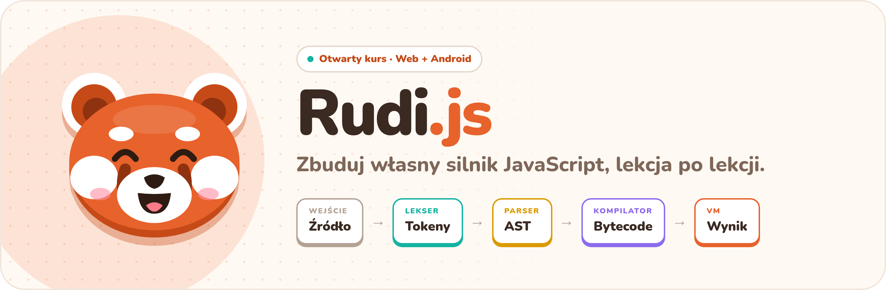
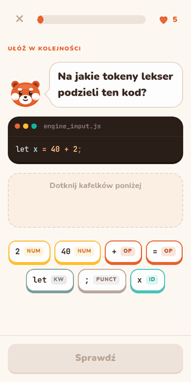
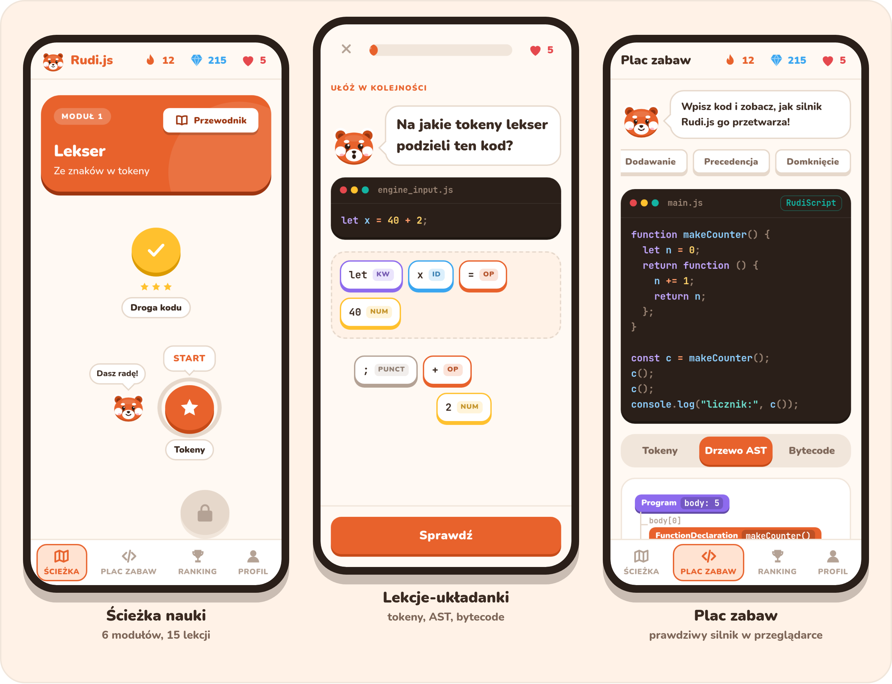
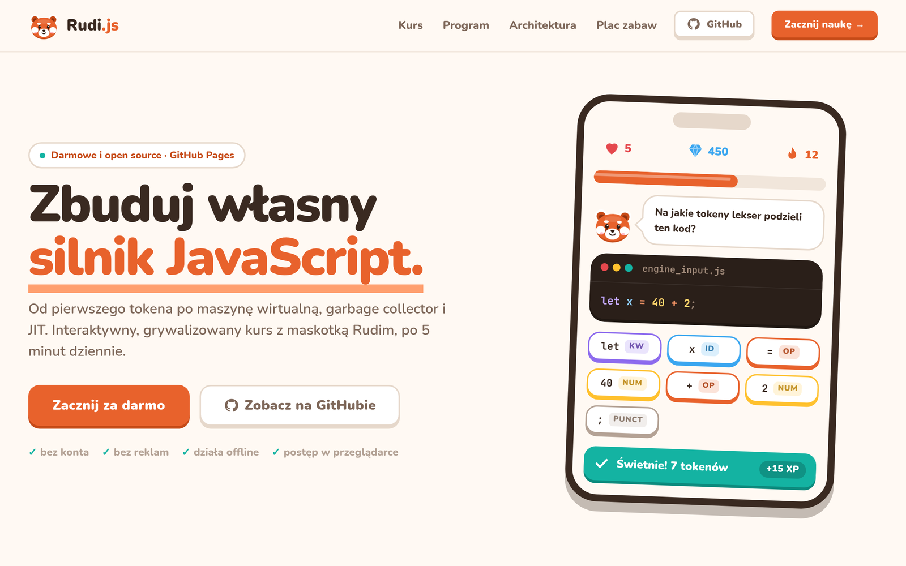
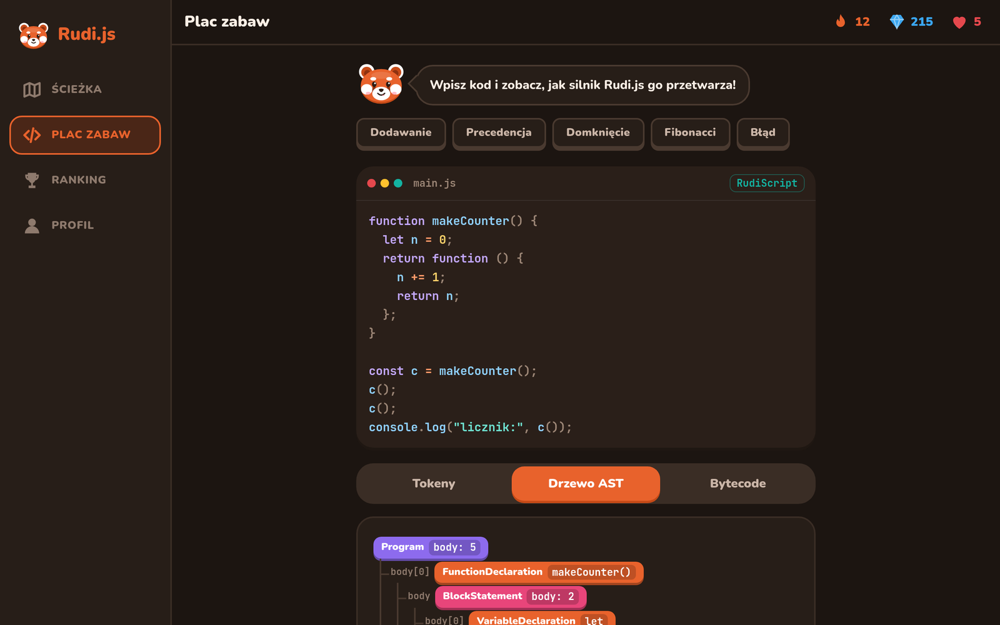
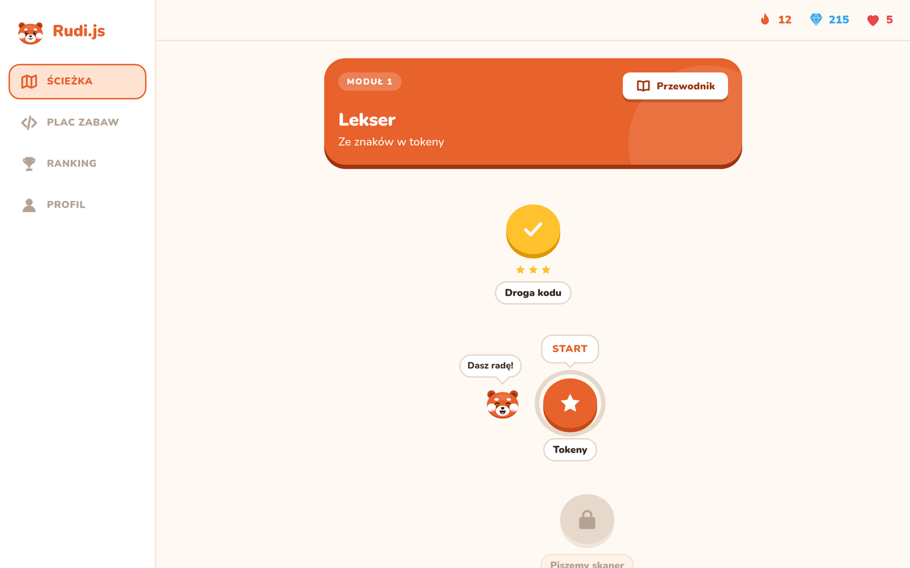
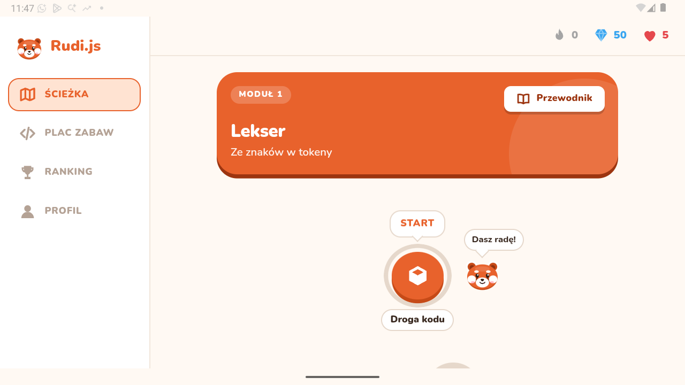
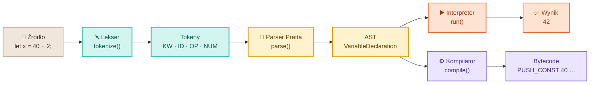

<p align="center">
  <a href="https://chiddekel.github.io/rudi-js/">
    <picture>
      <source media="(prefers-color-scheme: dark)" srcset="docs/readme/banner-dark.png">
      
    </picture>
  </a>
</p>

<p align="center">
  <a href="https://chiddekel.github.io/rudi-js/"></a>
  <a href="https://github.com/chiddekel/rudi-js/actions/workflows/ci.yml"></a>
  
  
  <a href="LICENSE"></a>
</p>

<p align="center">
  <b><a href="https://chiddekel.github.io/rudi-js/">Strona</a></b> ·
  <b><a href="https://chiddekel.github.io/rudi-js/app.html">Zacznij kurs</a></b> ·
  <b><a href="https://chiddekel.github.io/rudi-js/app.html#/play">Plac zabaw</a></b> ·
  <b><a href="https://chiddekel.github.io/rudi-js/design-system.html">Design system</a></b>
</p>

---

**Rudi.js** to otwarty, grywalizowany kurs, w którym krok po kroku budujesz własny silnik JavaScript: od pierwszego tokena, przez parser Pratta i drzewo AST, po maszynę wirtualną, garbage collector i JIT. Prowadzi Cię Rudi, czerwona panda, w krótkich, 5-minutowych lekcjach.

> *Open, gamified course: build your own JavaScript engine (lexer → Pratt parser → AST → interpreter → bytecode VM → GC → JIT). Polish UI, runs in the browser and on Android, zero dependencies.*

<table>
  <tr>
    <td width="340" align="center" valign="top">
      
    </td>
    <td valign="top">

### ✨ Co w środku

- 🧩 **Lekcje-układanki**: dziel kod na tokeny, układaj węzły AST, przewiduj wynik i bytecode.
- ⚙️ **Prawdziwy silnik w przeglądarce**: RudiScript z lekserem, parserem Pratta, interpreterem z domknięciami i kompilatorem do bytecode'u.
- 🧪 **Plac zabaw**: piszesz kod i na żywo widzisz tokeny, drzewo AST, bytecode i wynik.
- 🔥 **Grywalizacja**: seria dni, XP, klejnoty, serca, odznaki, skrzynie i liga.
- 🐼 **Rudi żyje**: 10 pogodnych min, płynne animacje i radość przy każdym ukończonym etapie.
- 📱 **Web + Android 8.0+**: PWA i natywna aplikacja z **GeckoView** — działa offline nawet bez systemowego WebView.
- 🌗 **Jasny i ciemny motyw**, skalowanie z rozmiarem tekstu (`rem`), obsługa `prefers-reduced-motion`.
- 🪶 **Zero zależności** w kursie: czysty HTML, CSS i JS, bez builda.

    </td>
  </tr>
</table>

## 📸 Zrzuty ekranu

<picture>
  <source media="(prefers-color-scheme: dark)" srcset="docs/readme/showcase-dark.png">
  
</picture>

<table>
  <tr>
    <td width="50%"><p align="center"><b>Strona</b> · plac zabaw działający na żywo</p></td>
    <td width="50%"><p align="center"><b>Plac zabaw</b> · drzewo AST, tryb ciemny</p></td>
  </tr>
  <tr>
    <td width="50%"><p align="center"><b>Desktop</b> · boczne menu, ścieżka lekcji</p></td>
    <td width="50%"><p align="center"><b>Android</b> · GeckoView, offline od API 26</p></td>
  </tr>
</table>

## 🗺️ Program kursu

| | Moduł | Lekcje | O czym |
|:-:|---|---|---|
| 🟠 | **1. Lekser** | Droga kodu · Tokeny · Piszemy skaner | znaki → tokeny, maximal munch |
| 🔵 | **2. Parser** | Drzewo AST · Precedencja · Instrukcje | ESTree, parser Pratta, łączność operatorów |
| 🟢 | **3. Interpreter** | Chodzenie po drzewie · Zakresy · Domknięcia | środowiska, `const`, domknięcia |
| 🟣 | **4. Bytecode VM** | Maszyna stosowa · Skoki | `PUSH_CONST`, `JUMP_IF_FALSE`, pętle |
| 🩷 | **5. Pamięć i GC** | Mark & sweep · Generacje | korzenie, cykle, scavenge |
| 🟡 | **6. JIT** | Ukryte klasy · Poziomy kompilacji | inline cache, Ignition → TurboFan, deoptymalizacja |

**6 modułów · 15 lekcji · 44 zadania** w trzech formatach: wybór odpowiedzi, układanie kafelków i wpisywanie wyniku. Testy sprawdzają w silniku każdą odpowiedź, która jest kodem.

## 🧠 Jak to działa



Cały silnik (`js/engine.js`) to ~340 linii czytelnego JS, który możesz rozebrać na części:

```js
const { tokens, ast, bytecode, run } = RudiEngine.evaluate(`
  function makeCounter() { let n = 0; return function () { n += 1; return n; }; }
  const c = makeCounter(); c(); c();
  console.log("licznik:", c());
`);
run.output;          // ["licznik: 3"]
bytecode[0].code[0]; // { op: "MAKE_CLOSURE", arg: "fn makeCounter()" }
```

## 🚀 Szybki start

```sh
git clone https://github.com/chiddekel/rudi-js.git
cd rudi-js
xdg-open app.html             # albo: python3 -m http.server 8080
npm test                      # node:test: silnik + spójność kursu
```

**Android 8.0+** (Kotlin + **GeckoView**, offline, bez uprawnienia INTERNET):

Aplikacja nie polega na systemowym WebView. Host kopiuje bundel kursu do prywatnego katalogu aplikacji i ładuje go przez `file://`, więc nawigacja (`location.hash`) działa na API 26+ także wtedy, gdy dostawca WebView jest niedostępny.

```sh
cd android
./gradlew assembleDebug
# APK per ABI, np.:
#   app/build/outputs/apk/debug/app-x86_64-debug.apk
#   app/build/outputs/apk/debug/app-arm64-v8a-debug.apk
```

Gotowe APK z każdego builda znajdziesz w artefaktach [GitHub Actions](https://github.com/chiddekel/rudi-js/actions/workflows/ci.yml). CI kończy się błędem przy każdym ostrzeżeniu Gradle, Kotlina lub lintu.

**Szybkie sprawdzenie UI na emulatorze** (wymaga jawnego seriala ADB; nie czyści danych aplikacji):

```sh
python3 tests/android/ui.py emulator-5554          # wypisz widoczne etykiety
python3 tests/android/ui.py emulator-5554 "Lekcja" # stuknij po etykiecie a11y
```

Checklistę i znane poprawki Android 8 znajdziesz w [`docs/qa/android-8.md`](docs/qa/android-8.md).

<details>
<summary><b>📁 Struktura projektu</b></summary>

| Ścieżka | Co |
|---|---|
| `index.html` | Strona promocyjna (GitHub Pages) z placem zabaw na żywo |
| `app.html` | Aplikacja: ścieżka, lekcje, plac zabaw, ranking, profil |
| `design-system.html` | Design system Rudi: tokeny, komponenty, miny maskotki |
| `js/engine.js` | RudiScript: lekser → parser Pratta → AST → interpreter + kompilator bytecode |
| `js/course.js` | Treść kursu: 6 modułów, 15 lekcji, 44 zadania |
| `js/app.js` · `js/rudi.js` · `js/viz.js` | Logika aplikacji, maskotka i miny, wizualizacje (kod, tokeny, AST) |
| `css/` | `tokens.css`, `components.css`, `app.css`, `landing.css`, `fonts.css` |
| `fonts/` | Nunito + JetBrains Mono (OFL), hostowane lokalnie |
| `android/` | Aplikacja Android: Kotlin + GeckoView, AGP 9, `minSdk 26`, `targetSdk 37`, APK per ABI |
| `tests/` | `node:test`: silnik i treść kursu |
| `tests/android/ui.py` | Sterownik ADB po etykietach accessibility (E2E na emulatorze) |
| `docs/qa/android-8.md` | Checklist i poprawki QA dla Android 8 / API 26 |
| `stitch/` | Ekrany z Google Stitch, wizualna referencja projektu |
| `docs/readme/` | Grafiki tego README |

</details>

<details>
<summary><b>➕ Dodaj własną lekcję</b></summary>

Kurs to dane w `js/course.js`. Nowe zadanie to jeden obiekt:

```js
{ kind: "input", q: "Co wypisze program?", code: "console.log(2 ** 3 ** 2);", answer: "512",
  explain: "** jest prawostronnie łączny: 2 ** (3 ** 2)." }
```

Dostępne typy: `choice` (wybór), `order` (układanie kafelków), `input` (wpisz wynik). `npm test` sprawdzi, czy odpowiedzi zgadzają się z silnikiem.

</details>

## 🎨 Design

Wygląd zaprojektowano w **[Google Stitch](https://stitch.withgoogle.com/)** (referencje w `stitch/`) i zbudowano jako własny design system: grube zaokrąglenia, przyciski 3D z twardym cieniem i ciepła paleta oparta na kolorze Rudiego. Maskotka to oryginalna czerwona panda w SVG z 10 minami. Animacje korzystają tylko z `transform` i `opacity`, więc pracuje przy nich karta graficzna.

## 📄 Licencja

[MIT](LICENSE) © 2026 chiddekel · czcionki: [SIL Open Font License](https://openfontlicense.org/)

<p align="center"><sub>Zrobione z 🧡 dla wszystkich, którzy chcą wiedzieć, co dzieje się po naciśnięciu <kbd>Enter</kbd> w konsoli.</sub></p>
