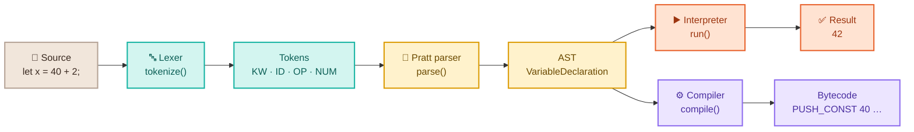

<p align="center">
  <a href="https://chiddekel.github.io/rudi-js/">
    <picture>
      <source media="(prefers-color-scheme: dark)" srcset="docs/readme/banner-dark.png">
      
    </picture>
  </a>
</p>

<p align="center">
  <a href="https://chiddekel.github.io/rudi-js/"></a>
  <a href="https://github.com/chiddekel/rudi-js/actions/workflows/ci.yml"></a>
  
  
  <a href="LICENSE"></a>
</p>

<p align="center">
  <b><a href="https://chiddekel.github.io/rudi-js/">Site</a></b> ·
  <b><a href="https://chiddekel.github.io/rudi-js/app.html">Start the course</a></b> ·
  <b><a href="https://chiddekel.github.io/rudi-js/app.html#/play">Playground</a></b> ·
  <b><a href="https://chiddekel.github.io/rudi-js/design-system.html">Design system</a></b>
</p>

---

**Rudi.js** is an open, gamified course where you build your own JavaScript engine step by step: from the first token, through a Pratt parser and AST, to a virtual machine, garbage collector, and JIT. Rudi the red panda guides you in short, five-minute lessons.

> *Lexer → Pratt parser → AST → interpreter → bytecode VM → GC → JIT. Runs in the browser and on Android. UI in 15 languages; course content in Polish and English.*

<table>
  <tr>
    <td width="340" align="center" valign="top">
      
    </td>
    <td valign="top">

### ✨ What's inside

- 🧩 **Puzzle lessons**: split code into tokens, arrange AST nodes, predict results and bytecode.
- ⚙️ **A real engine in the browser**: RudiScript with a lexer, Pratt parser, interpreter with closures, and a bytecode compiler.
- 🧪 **Playground**: write code and see tokens, AST, bytecode, and output live.
- 🔥 **Gamification**: day streaks, XP, gems, hearts, badges, chests, and a league.
- 🐼 **Rudi is alive**: 10 cheerful moods, smooth animations, and a celebration after every stage.
- 📱 **Web + Android 8.0+**: PWA and a native app on **GeckoView** — works offline even without a system WebView.
- 🌗 **Light and dark themes**, scales with text size (`rem`), respects `prefers-reduced-motion`.
- 🌍 **15 languages (i18n/l10n)**: en, pl, de, fr, es, it, pt-BR, uk, ar (RTL), hi, zh-CN, zh-TW, ja, ko, tr — app and GitHub Pages landing UI in each; course content in Polish and English (other languages get UI + English course). Use `?lang=` or the nav language picker. JSON placeholders: Mustache `{{var}}` (`js/vendor/mustache.min.js`).
- 🪶 **Zero npm dependencies**: plain HTML, CSS, and JS — no build step. Mustache is vendored for locale templates.

    </td>
  </tr>
</table>

## 📸 Screenshots

<picture>
  <source media="(prefers-color-scheme: dark)" srcset="docs/readme/showcase-dark.png">
  
</picture>

<table>
  <tr>
    <td width="50%"><p align="center"><b>Site</b> · live playground on the landing</p></td>
    <td width="50%"><p align="center"><b>Playground</b> · AST tree, dark mode</p></td>
  </tr>
  <tr>
    <td width="50%"><p align="center"><b>Desktop</b> · side nav, lesson path</p></td>
    <td width="50%"><p align="center"><b>Android</b> · GeckoView, offline from API 26</p></td>
  </tr>
</table>

## 🗺️ Course syllabus

| | Module | Lessons | About |
|:-:|---|---|---|
| 🟠 | **1. Lexer** | The code's journey · Tokens · Writing a scanner | characters → tokens, maximal munch |
| 🔵 | **2. Parser** | The AST · Precedence · Statements | ESTree, Pratt parser, operator associativity |
| 🟢 | **3. Interpreter** | Walking the tree · Scopes · Closures | environments, `const`, closures |
| 🟣 | **4. Bytecode VM** | Stack machine · Jumps | `PUSH_CONST`, `JUMP_IF_FALSE`, loops |
| 🩷 | **5. Memory & GC** | Mark & sweep · Generations | roots, cycles, scavenge |
| 🟡 | **6. JIT** | Hidden classes · Compilation tiers | inline caches, Ignition → TurboFan, deoptimization |

**6 modules · 15 lessons · 44 exercises** in three formats: multiple choice, tile ordering, and typed answers. Tests verify every code answer against the engine.

## 🧠 How it works



The whole engine (`js/engine.js`) is ~340 lines of readable JS you can take apart:

```js
const { tokens, ast, bytecode, run } = RudiEngine.evaluate(`
  function makeCounter() { let n = 0; return function () { n += 1; return n; }; }
  const c = makeCounter(); c(); c();
  console.log("count:", c());
`);
run.output;          // ["count: 3"]
bytecode[0].code[0]; // { op: "MAKE_CLOSURE", arg: "fn makeCounter()" }
```

## 🚀 Quick start

```sh
git clone https://github.com/chiddekel/rudi-js.git
cd rudi-js
xdg-open app.html             # or: python3 -m http.server 8080
npm test                      # node:test — engine + course consistency
```

**Android 8.0+** (Kotlin + **GeckoView**, offline, no INTERNET permission):

The app does not rely on the system WebView. The host copies the course bundle into private app storage and loads it over `file://`, so navigation (`location.hash`) works on API 26+ even when the vendor WebView is unavailable.

```sh
cd android
./gradlew assembleDebug
# Per-ABI APKs, e.g.:
#   app/build/outputs/apk/debug/app-x86_64-debug.apk
#   app/build/outputs/apk/debug/app-arm64-v8a-debug.apk
```

Signed APKs from every tagged release land in [GitHub Releases](https://github.com/chiddekel/rudi-js/releases). Debug CI artifacts are on [GitHub Actions](https://github.com/chiddekel/rudi-js/actions/workflows/ci.yml). CI fails on any Gradle, Kotlin, or lint warning.

**Quick UI check on an emulator** (needs an explicit ADB serial; does not wipe app data):

```sh
python3 tests/android/ui.py emulator-5554          # list visible labels
python3 tests/android/ui.py emulator-5554 "Lesson" # tap by a11y label
```

Android 8 checklist and known fixes: [`docs/qa/android-8.md`](docs/qa/android-8.md).

<details>
<summary><b>📁 Project layout</b></summary>

| Path | What |
|---|---|
| `index.html` | GitHub Pages landing (full i18n) with a live playground |
| `app.html` | App: path, lessons, playground, ranking, profile |
| `design-system.html` | Rudi design system: tokens, components, mascot moods |
| `js/engine.js` | RudiScript: lexer → Pratt parser → AST → interpreter + bytecode compiler |
| `js/course.js` | Course content: 6 modules, 15 lessons, 44 exercises |
| `js/app.js` · `js/rudi.js` · `js/viz.js` · `js/i18n.js` | App, mascot, visualizations, localization |
| `js/vendor/mustache.min.js` | Mustache 4.2.0 — render `{{var}}` from JSON catalogs |
| `locales/` | UI + course catalogs (`en`, `pl`, …) loaded at runtime |
| `css/` | `tokens.css`, `components.css`, `app.css`, `landing.css`, `fonts.css` |
| `fonts/` | Nunito + JetBrains Mono (OFL), hosted locally |
| `android/` | Android app: Kotlin + GeckoView, AGP 9, `minSdk 26`, `targetSdk 37`, per-ABI APKs |
| `tests/` | `node:test`: engine and course content |
| `tests/android/ui.py` | ADB driver by accessibility labels (emulator E2E) |
| `docs/qa/android-8.md` | QA checklist and fixes for Android 8 / API 26 |
| `stitch/` | Google Stitch screens, visual project reference |
| `docs/readme/` | Graphics for this README |

</details>

<details>
<summary><b>➕ Add your own lesson</b></summary>

The course is data in `js/course.js`. A new exercise is one object:

```js
{ kind: "input", q: "What does the program print?", code: "console.log(2 ** 3 ** 2);", answer: "512",
  explain: "** is right-associative: 2 ** (3 ** 2)." }
```

Available kinds: `choice`, `order` (tile sorting), `input` (type the result). `npm test` checks that answers match the engine.

</details>

## 🎨 Design

The look was designed in **[Google Stitch](https://stitch.withgoogle.com/)** (references in `stitch/`) and shipped as a custom design system: chunky radii, 3D buttons with hard shadows, and a warm palette based on Rudi's fur. The mascot is an original red panda in SVG with 10 moods. Animations use only `transform` and `opacity`, so the GPU does the work.

## 📄 License

[MIT](LICENSE) © 2026 chiddekel · fonts: [SIL Open Font License](https://openfontlicense.org/)

<p align="center"><sub>Made with 🧡 for everyone who wants to know what happens after pressing <kbd>Enter</kbd> in the console.</sub></p>
